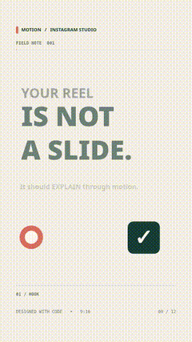
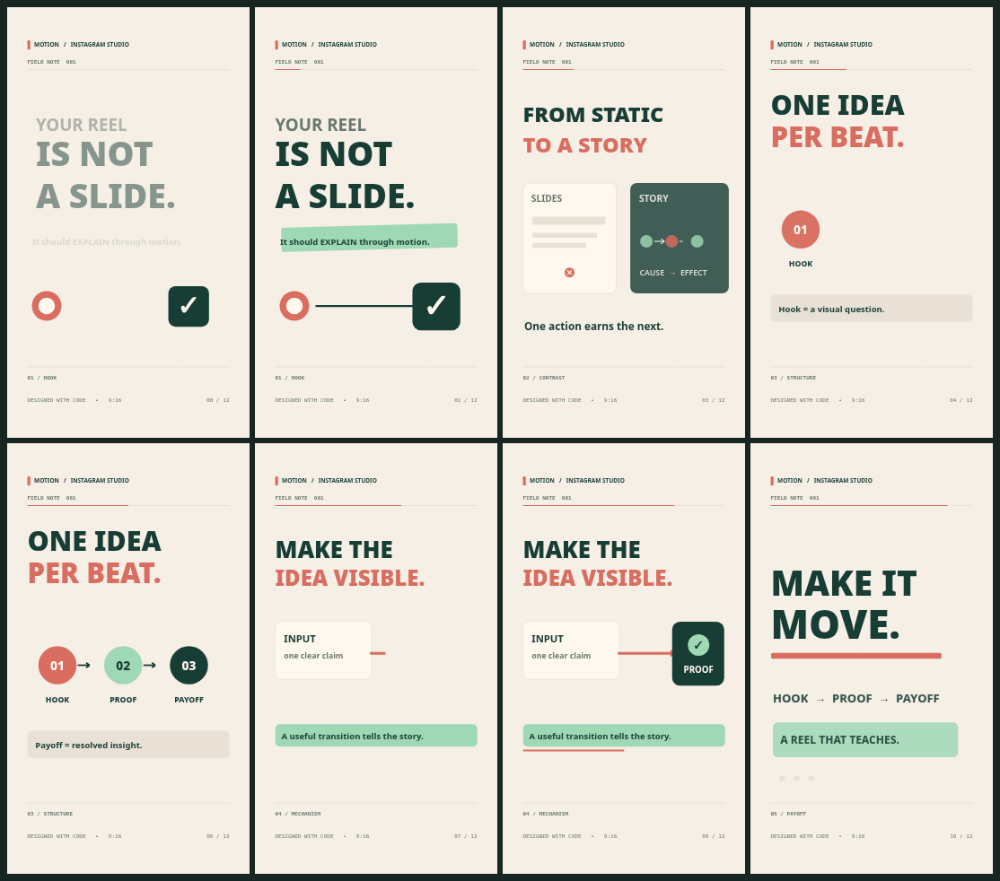

# Instagram Motion Graphics Reels

**Professional Instagram Reels, TikToks and YouTube Shorts — directed by ChatGPT, Claude Code, Codex or Antigravity, animated in code, and rendered frame-by-frame to MP4.**

[](https://github.com/chhatramani01/instagram-motiongraphics-reels/actions/workflows/test.yml)    



<details><summary><strong>View actual rendered 12-second storyboard contact sheet</strong></summary>



</details>

[**Try in ChatGPT**](prompts/PASTE_IN_CHATGPT.md) · [**Install to an agent**](docs/INSTALL.md) · [**Full skill**](instagram-reels/SKILL.md) · [**Style gallery**](instagram-reels/styles/INDEX.md) · [**Rendered demo**](instagram-reels/examples/demo/reel-preview.mp4)

> One portable skill, twelve thoroughly specified aesthetic directions, one working deterministic render/audio pipeline. This is **not** an AI video foundation model. Agent instructions cannot grant terminal access by themselves. The demo includes original synthesized SFX, **not** synthesized narration. Source art and commercial tracks are not included.

## Make a Reel from one request

> "Make a premium 15-second 9:16 Reel explaining why a GPT agent is different from a chatbot. Use warm editorial style, beautiful connected UI diagrams, smooth professional easing, synced narration if I attach audio, tasteful SFX, and a meaningful first-second hook. Show the visual storyboard first; after approval render the video and inspect every scene."

What happens: **creative brief → visual storyboard → time-pure Canvas scene → contact sheet → half-resolution draft → 1080×1920 H.264 → offline AAC audio mux → verification → release critique**.

## Install and run

If you just want to use ChatGPT, [copy the complete paste-in prompt](prompts/PASTE_IN_CHATGPT.md). When in a coding agent, clone the repository and open its root. Codex and Antigravity discover `.agents/skills/instagram-reels/SKILL.md`; Claude Code discovers `.claude/skills/instagram-reels/SKILL.md`. Both forward to the same portable package in `instagram-reels/`.

To render the real demo yourself (Python 3.10+, FFmpeg, FFprobe and Chromium required):

```bash
git clone https://github.com/chhatramani01/instagram-motiongraphics-reels.git
cd instagram-motiongraphics-reels
python -m pip install -r requirements.txt
python -m playwright install chromium
python instagram-reels/scripts/check.py
python instagram-reels/scripts/demo.py --draft  # Quick 360×640 preview
python instagram-reels/scripts/demo.py --full   # Final 1080×1920 / 30fps
```

Exports are written to `output/`: `reel.mp4`, `contact-sheet.png`, source `silent.mp4`, `effects.wav`, `report.json`. The complete original demo source is in [`instagram-reels/examples/demo/`](instagram-reels/examples/demo/). To add your own licensed voice/music to a render:

```bash
python instagram-reels/scripts/mux.py \
  --video output/silent.mp4 \
  --effects output/effects.wav \
  --voice my_voice.wav --music cleared_music.mp3 \
  --output output/reel-with-voice.mp4
python instagram-reels/scripts/verify.py output/reel-with-voice.mp4 --width 1080 --height 1920
```

The optional mixer prioritizes speech using fixed relative levels. It is **not** adaptive sidechain ducking. Captions are only word-accurate when supplied with real measured word alignment.

## The 12 visual directions

These are detailed, expandable design specifications, not separate render engines. The included demo implements the **warm editorial** approach.

| Visual style | Best for |
|---|---|
| [Warm Editorial Product](instagram-reels/styles/warm-editorial.md) | Founder stories, AI workflows, product explanations |
| [Kinetic Whiteboard Notes](instagram-reels/styles/kinetic-whiteboard.md) | Typographic AI/design tutorials |
| [Premium Paper-Cut Storybook](instagram-reels/styles/premium-paper-cut.md) | Emotional and cultural storytelling |
| [Pixel Quest Story](instagram-reels/styles/pixel-quest.md) | Quest mechanics, agent/tool learning |
| [Blueprint Logic](instagram-reels/styles/blueprint-logic.md) | Engineering and system visuals |
| [Source Proof Montage](instagram-reels/styles/proof-montage.md) | Research, news and evidence-led videos |
| [Graphic Novel Halftone](instagram-reels/styles/graphic-novel.md) | Comic stories and contrasts |
| [Clean Product UI](instagram-reels/styles/clean-product-ui.md) | Software feature demos |
| [Type-Driven Studio](instagram-reels/styles/type-driven.md) | Big kinetic words and lyric motion |
| [Soft Clay Infographics](instagram-reels/styles/soft-clay.md) | Friendly educational diagrams |
| [Cinematic Luxe Title](instagram-reels/styles/cinematic-luxe.md) | Premium launch reveals |
| [Illustrated Journey Map](instagram-reels/styles/map-journey.md) | Location-based travel/story explanations |

Each style guide has its own color system, composition, motion vocabulary, transition rules, sound cues and a visual quality rejection checklist. Add new directions by adding a Markdown file and a row in [`registry.json`](instagram-reels/styles/registry.json).

## How the files work

```text
instagram-reels/
  SKILL.md                      # Canonical complete Instagram Reel agent instructions
  references/                   # Retention, motion, layouts, audio, ethics, provenance
  styles/                       # 12 extendable style direction documents and registry.json
  examples/demo/scene.html      # Working time-pure Canvas animation
  examples/demo/storyboard.md   # Visual beat plan
  examples/demo/sfx.json        # Time-locked original sound cues
  scripts/                      # Real browser renderer, foley, mux, contact sheet and QA
.agents/skills/instagram-reels/ # Thin discovery entrypoint for Codex / Antigravity
.claude/skills/instagram-reels/ # Thin discovery entrypoint for Claude Code
prompts/PASTE_IN_CHATGPT.md     # Plain ChatGPT instruction text (no native installation)
docs/INSTALL.md                 # Platform-specific setup
.github/workflows/test.yml      # CI tests a real short MP4 with sound
```

There is no redundant copy of OpenNolan's huge private skill library. Reference files are loaded only when relevant to the creative brief.

## Contributing and provenance

This original standalone skill draws broad creative principles from [het8802/OpenNolan Instagram Reels](https://github.com/het8802/OpenNolan/tree/main/skills/social-media/instagram-reels), including attention engineering, visual/spoken/audio hooks, safe layouts and editorial motion design. OpenNolan is distributed under **AGPL-3.0**; its source code, copyrighted images and unreleased sessions are **not copied or bundled** here. See [the adaptation audit](instagram-reels/references/provenance.md) and [contribution guide](CONTRIBUTING.md).

The new repository's original software is released under [MIT](LICENSE). There is no guaranteed engagement performance, no auto-posting to Instagram, and no implied license for any external media.
